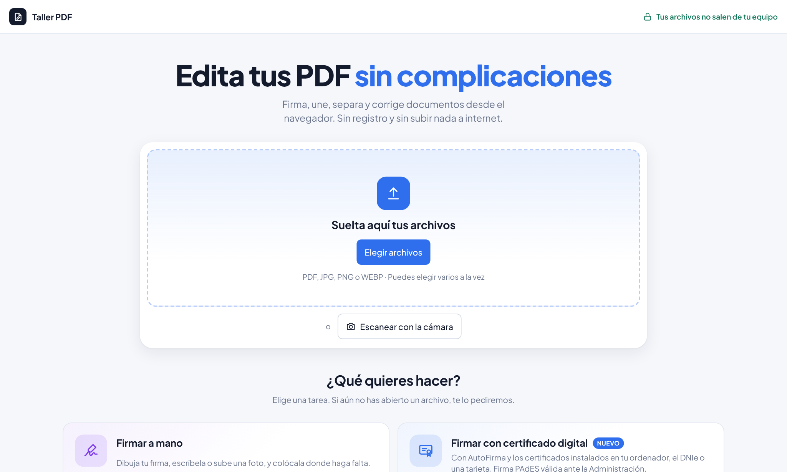

# Taller PDF

Herramienta web para trabajar con archivos PDF **sin que los documentos salgan del dispositivo**: editar, firmar (a mano o con certificado digital), unir, separar, comprimir, escanear, censurar y proteger con contraseña.

Está pensada para el personal de un centro educativo, que maneja a diario documentos con datos personales de alumnado y familias y no debería subirlos a servicios de terceros.

- **Aplicación en funcionamiento:** https://pdf.colegiosanjuandeavila.com
- **Código:** https://github.com/tompedu/taller-pdf
- **Presentación (slides):** [`docs/presentacion.pptx`](docs/presentacion.pptx)
- **Vídeo explicativo:** _PENDIENTE: añadir enlace_
- **Autor:** _PENDIENTE: nombre y apellidos_
- Trabajo Final de Máster · Máster en Desarrollo con IA (BIG school)

> **Usuario de prueba:** no hace falta. La aplicación no tiene registro ni inicio de sesión.

## Descripción general

Los editores de PDF en línea más conocidos funcionan subiendo el documento a sus servidores. Para un colegio eso supone enviar a una empresa externa actas, informes, matrículas o justificantes con datos de menores.

Taller PDF hace todo el trabajo **en el navegador de quien lo usa**:

- El servidor solo entrega la página; nunca recibe los documentos.
- No usa cookies, ni analítica, ni recursos de otras empresas: las tipografías y las librerías están alojadas en el propio servidor.
- No necesita base de datos, ni PHP, ni ningún programa en el servidor. Sirve cualquier alojamiento de archivos estáticos con HTTPS.
- Se puede instalar como aplicación (PWA) en el ordenador o en el móvil y funciona sin conexión una vez cargada.



Además, permite **firmar con certificado digital** (certificados instalados, DNIe o tarjeta) a través de AutoFirma, la aplicación gratuita del Gobierno de España. El resultado es una firma PAdES como la que usan las sedes electrónicas.

## Funcionalidades principales

| Grupo | Qué permite |
|---|---|
| Firmar | Firma a mano (dibujada, escrita o desde una foto) y firma con certificado digital mediante AutoFirma |
| Editar | Cambiar el texto del documento, escribir encima, rellenar formularios, resaltar, dibujar, añadir formas, marcas, fecha e imágenes |
| Privacidad | Censurar datos (tapar en negro y eliminar la información), proteger con contraseña, quitar la contraseña de un PDF si se conoce |
| Páginas | Unir varios PDF, separar en varios, organizar y girar páginas, numerar páginas, añadir marca de agua |
| Tamaño y reparación | Comprimir (tres niveles) y reparar PDF dañados |
| Entrada y salida | Escanear un documento con la cámara del móvil (detecta los bordes y lo endereza), convertir fotos a PDF y exportar un PDF a imágenes JPG |
| Aplicación instalable | Instalación como PWA, uso sin conexión, accesos directos (escanear, firmar, unir, editar) y recepción de archivos compartidos desde otras aplicaciones en Android |

## Stack tecnológico

- **HTML, CSS y JavaScript** sin framework ni proceso de compilación. El código está dividido en archivos por función, que se cargan en orden y comparten ámbito.
- **[pdf-lib](https://pdf-lib.js.org/)**: creación y modificación de PDF (licencia MIT).
- **[pdf.js](https://mozilla.github.io/pdf.js/) 3.11.174**: lectura y dibujo de las páginas (licencia Apache 2.0).
- **[SortableJS](https://sortablejs.github.io/Sortable/) 1.15.2**: reordenar páginas arrastrando (licencia MIT).
- **autoscript.js** del [Cliente @firma / AutoFirma](https://github.com/ctt-gob-es/clienteafirma): comunicación con AutoFirma (licencia dual GPL 2+ / EUPL 1.1).
- **Service worker y Web App Manifest** para la instalación y el uso sin conexión.
- **Apache** (`.htaccess`) para forzar HTTPS, la caché y las cabeceras de seguridad (Content-Security-Policy, entre otras).
- **[Playwright](https://playwright.dev/)** para las pruebas automáticas (solo en desarrollo).
- Tipografías Plus Jakarta Sans, IBM Plex Mono, Caveat, Dancing Script y Allura, alojadas en el propio servidor.

Las licencias de las librerías están en `public/vendor/LICENCIAS/`.

## Instalación y ejecución

### En local

La aplicación no tiene dependencias: basta con servir la carpeta `public/` con un servidor web, porque el navegador no la carga abriendo el archivo directamente.

```bash
git clone https://github.com/tompedu/taller-pdf.git
cd taller-pdf
npm start
```

Después abre http://localhost:8080. `npm start` usa un servidor mínimo incluido en `tools/servidor.js` y solo necesita [Node.js](https://nodejs.org/). Sin Node.js también sirve `python -m http.server 8080` dentro de `public/`.

La firma con certificado digital solo funciona con la web publicada con HTTPS y con AutoFirma instalada en el ordenador.

### Pruebas

Las pruebas abren la aplicación en un navegador real, hacen cada operación y comprueban el archivo descargado.

```bash
npm install
npx playwright install chromium
npm test
```

Cubren: unir, separar (por página, cada N páginas y por rangos), girar, eliminar, deshacer, proteger con contraseña, abrir un PDF protegido, numerar páginas, marca de agua, exportar a imágenes, convertir una foto en PDF, escribir texto en el editor, los accesos directos y el arranque con conexión lenta.

### En un servidor

Sube el contenido de `public/` a cualquier alojamiento con HTTPS. La guía paso a paso para un alojamiento compartido de IONOS está en [`docs/INSTALACION.md`](docs/INSTALACION.md).

## Estructura del proyecto

```
taller-pdf/
├── README.md
├── LICENSE                   Licencia GPL-3.0
├── package.json              Órdenes `npm start` y `npm test`
├── playwright.config.js      Configuración de las pruebas
├── docs/
│   ├── INSTALACION.md        Guía de instalación en IONOS y notas de uso
│   ├── presentacion.pptx     Slides del proyecto
│   └── capturas/             Capturas de pantalla
├── tests/
│   ├── taller-pdf.spec.js    Pruebas de extremo a extremo
│   └── ayudas.js             Utilidades de las pruebas
├── tools/
│   └── servidor.js           Servidor mínimo para probar en local
└── public/                   Todo lo que se publica en el servidor
    ├── index.html            La aplicación (una sola página)
    ├── assets/
    │   ├── app.css           Estilos
    │   ├── fonts.css         Declaración de las tipografías
    │   └── js/               Código de la aplicación (ver tabla)
    ├── sw.js                 Service worker (caché y uso sin conexión)
    ├── manifest.webmanifest  Datos de la aplicación instalable
    ├── icons/                Iconos de la aplicación y de los accesos directos
    ├── fonts/                Tipografías
    ├── vendor/               Librerías de terceros y sus licencias
    ├── favicon.svg
    ├── robots.txt            Evita que aparezca en buscadores
    └── .htaccess             HTTPS, caché y cabeceras de seguridad
```

Los archivos de `public/assets/js/` se cargan en este orden:

| Archivo | Contenido |
|---|---|
| `config.js` | Rutas de las librerías y opciones generales |
| `nucleo.js` | Utilidades comunes: selectores, avisos y descarga de archivos |
| `estado.js` | Estado de la aplicación e historial de deshacer y rehacer |
| `archivos.js` | Abrir PDF y fotos, contraseñas de apertura, arrastrar y soltar |
| `ajustes.js` | Lectura de las opciones de salida elegidas en el panel |
| `elementos.js` | Textos, formas, resaltados, imágenes y firmas sobre las páginas |
| `organizar.js` | Miniaturas, selección, reordenar, girar, duplicar y eliminar |
| `editor.js` | Herramientas del modo editar, puntero, edición de texto y teclado |
| `firma.js` | Firma a mano: dibujada, escrita o desde una foto |
| `autofirma.js` | Firma con certificado digital mediante AutoFirma |
| `escaner.js` | Escáner: detección de bordes, enderezado y acabado |
| `comprimir.js` | Compresión de imágenes y exportación de páginas como JPG |
| `exportar.js` | Construcción del PDF final, sellos, contraseña, separación y .zip |
| `render.js` | Decide qué vista se dibuja |
| `instalable.js` | Aviso de instalación, accesos directos y archivos compartidos |
| `inicio.js` | Arranque de la aplicación |

## Privacidad

- Los PDF se procesan en el dispositivo de cada persona; el servidor nunca los recibe.
- La web no usa cookies ni analítica.
- Las contraseñas que se ponen a los PDF no se guardan en ningún sitio.
- Como cualquier web, el proveedor de alojamiento guarda registros técnicos de acceso (IP, fecha, página visitada).

## Proceso de desarrollo

_PENDIENTE: explicar con tus palabras cómo se ha desarrollado el proyecto: cómo surgió la idea, qué herramientas de IA se han usado y para qué, qué decisiones técnicas se tomaron y qué problemas hubo que resolver._

## Mejoras previstas

_PENDIENTE: revisar y completar._

- Pasar el código a módulos ES (`import` / `export`) para que cada archivo declare de qué depende.
- Ampliar las pruebas a la firma a mano, la censura de datos y el escáner.

## Licencia

Taller PDF se distribuye bajo la licencia [GPL-3.0](LICENSE) o posterior.

Incluye librerías de terceros con sus propias licencias, recogidas en `public/vendor/LICENCIAS/`: pdf-lib (MIT), pdf.js (Apache 2.0), SortableJS (MIT) y autoscript.js del Cliente @firma (GPL 2+ / EUPL 1.1).
